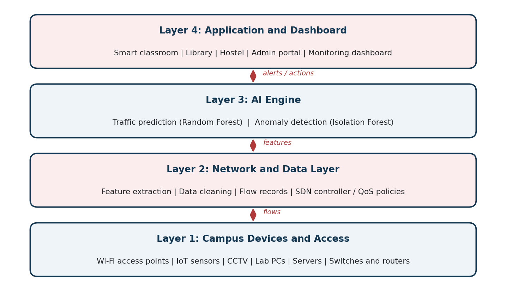
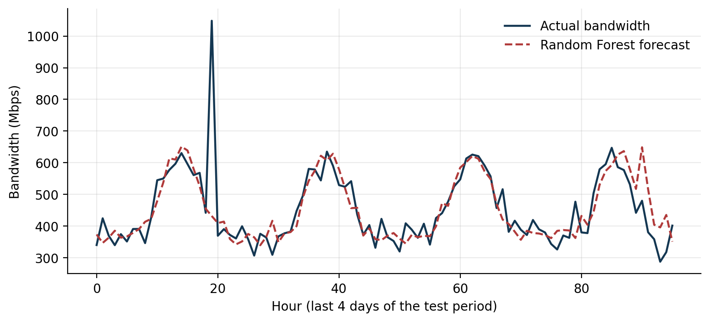

# AI-Driven Intelligent Network for Smart Campus Applications

Computer Networks mini project, UnitedWorld Institute of Technology, Karnavati University.

**Student:** Malani Khushi (202407020439)  
**Guide:** Ms. Pragya Vats

## Overview
A smart campus runs Wi-Fi, IoT sensors, CCTV and e-learning systems on one shared network. This project is a learning prototype that uses machine learning to:

- predict the bandwidth demand of the next hour (Random Forest, compared with Linear Regression and a naive baseline), and
- flag unusual traffic (Isolation Forest),

so that an administrator can get early warning of congestion and suggestions for QoS decisions.



## Repository contents
| Path | Description |
|---|---|
| `prototype.py` | Full prototype: data simulation, features, models, metrics |
| `requirements.txt` | Python libraries needed |
| `figures/` | Architecture, topology, workflow and output charts |
| `report/` | Mini project report (Word) |
| `presentation/` | Project presentation (PowerPoint) |

## How to run
```
pip install -r requirements.txt
python prototype.py
```
The script simulates 60 days of hourly campus traffic, trains the models on the first 75% of the data (split by time) and prints the error of each forecasting model and the precision and recall of the anomaly detector.

## Results (simulated data)
| Model | MAE (Mbps) |
|---|---|
| Naive (same hour yesterday) | 101.6 |
| Linear Regression | 48.3 |
| Random Forest | 42.0 |

The Isolation Forest found all 7 inserted traffic spikes in the test period (recall 1.00) with precision 0.50, so some false alarms should be expected.

These numbers come from a **simulated dataset**, so they show how the method works and are not measurements of a real campus network.



## Limitations
Results depend on data quality, predictions can be wrong, and alerts need human review. Real network data must be anonymised and used only with permission.

## References
See the report for the full reference list.
